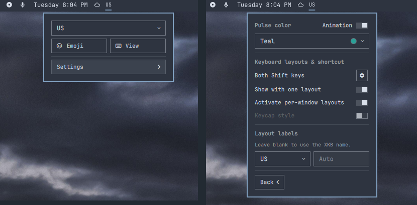

# Keyboard Layout Pulse



Switch keyboard layouts from the Omarchy Quattro bar, with an optional color
pulse to make each change easy to spot. Add custom labels or open an on-screen
keyboard while keeping focus in your application.

## Requirements

- Omarchy Quattro >= 4.0.0
- One or more keyboard layouts in `~/.config/hypr/input.lua`
- x86-64, `json-c`, `libxkbcommon`, and `libutf8proc` for the keyboard viewer
  and per-window layouts
- `wtype` for click-to-type input

The native helper is bundled for x86-64. Other architectures need a native
build for the viewer and per-window layouts; layout selection still works.

## Install

```bash
omarchy plugin add https://github.com/omarchy-QOL/omarchy-keyboard-layout.git --enable
```

The plugin replaces Omarchy's built-in keyboard widget. Disabling or removing
it restores the built-in widget in the same position.

## Use

- Left-click or right-click the bar label to open the layout menu.
- Select a layout, or scroll over the bar label to cycle through layouts.
- Choose **Emoji** for Omarchy's emoji picker or **View** for the keyboard
  viewer.
- Open **Settings** to customize the widget.

Variants appear in labels such as `US(intl)`. Under **Layout labels**, select a
layout and enter a custom label. Press Enter or leave the field to save; leave
it blank to restore the automatic label. Preferences survive restarts.

**Animation** is on by default. Choose a preset pulse color or enter a custom
six-digit hex color. Turn animation off to switch layouts without a pulse.

Enable **Show with one layout** to keep the widget visible when only one layout
is configured. **Keycap style** adds a compact background behind the bar label
and works with the pulse animation; it is off by default.

Enable **Activate per-window layouts** to remember each window's layout.
Automatic restores do not pulse. Turn it off to use one layout across windows.

Settings shows Omarchy's layout switching shortcut, `Super + I` by default since
Omarchy 4.5. Rebind it in `~/.config/hypr/bindings.lua`. Without that binding,
Settings shows the XKB shortcut from `kb_options` instead.

To change configured layouts or the XKB shortcut, use the gear beside the
shortcut to open the relevant line in `~/.config/hypr/input.lua`. The plugin
reads this configuration without rewriting it.

## Keyboard viewer

The viewer follows the active layout and variant. Click keys to type into your
application without moving keyboard focus away from it.

- Click a modifier once for the next key; double-click to lock it.
- Hold a letter to choose an accent. Dead keys compose with the next key.
- Choose Auto, ANSI, ISO, ABNT, or JIS with the shape selector.
- Drag the top edge to move the viewer or the bottom corner to resize it.
- Use the close button to dismiss it.

Modifier buttons affect the viewer only. Physical key presses are not
highlighted.

## Demo

See layout switching and pulse colors in action:

<https://github.com/user-attachments/assets/9e631b8e-f155-45d1-9731-567414712d6a>

## Remove

```bash
omarchy plugin remove io.github.ilyazar.keyboard-layout --yes
```

Preferences are stored in Omarchy's `shell.json` and retained for reinstalling.

## License

MIT
